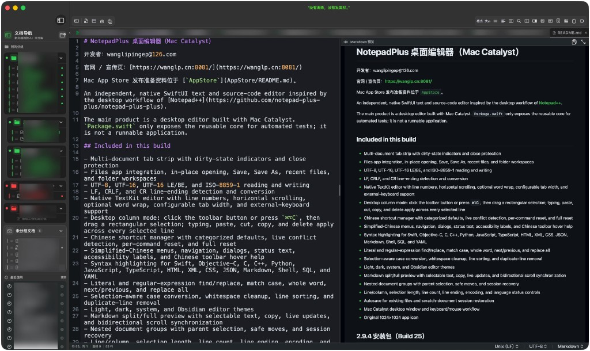

# NotepadPlus — macOS / Mac 桌面编辑器（Mac Catalyst）

**NotepadPlus** is a native **macOS** text and code editor for **Mac** (Apple Silicon & Intel), built with **Mac Catalyst** and SwiftUI. Search keywords: `notepadplus`, `notepad++`, `mac editor`, `macos text editor`, `markdown editor`.

开发者：wanglipingep@126.com

官网 / 宣传页：[https://wanglp.cn:8081/](https://wanglp.cn:8081/)

Mac App Store 发布准备资料位于 [`AppStore`](AppStore/README.md)。



An independent, native SwiftUI **Mac** text and source-code editor inspired by the desktop workflow of [Notepad++](https://github.com/notepad-plus-plus/notepad-plus-plus).

The main product is a desktop **macOS** editor built with Mac Catalyst. `Package.swift` only exposes the reusable core for automated tests; it is not a runnable application.

## Included in this build

- Multi-document tab strip with dirty-state indicators and close protection
- Files app integration, in-place opening, Save, Save As, recent files, and folder workspaces
- UTF-8, UTF-16, UTF-16 LE/BE, and ISO-8859-1 reading and writing
- LF, CRLF, and CR line-ending detection and conversion
- Native TextKit editor with line numbers, horizontal scrolling, optional word wrap, configurable tab width, and external-keyboard support
- Desktop column mode: click the toolbar button or press `⌘⌥C`, then drag a rectangular selection; typing, paste, cut, copy, and delete apply across every selected line
- Chinese shortcut manager with categorized defaults, live conflict detection, per-command reset, and full reset
- Simplified-Chinese menus, navigation, dialogs, status text, accessibility labels, and Chinese toolbar hover help
- Syntax highlighting for Swift, Objective-C, C, C++, Python, JavaScript, TypeScript, HTML, XML, CSS, JSON, Markdown, Shell, SQL, and YAML
- Literal and regular-expression find/replace, match case, whole word, next/previous, and replace all
- Selection-aware case conversion, whitespace cleanup, line sorting, and duplicate-line removal
- Light, dark, system, and Obsidian editor themes
- Markdown split/full preview with selectable text, copy, live updates, and bidirectional scroll synchronization
- Nested document groups with parent selection, safe moves, and session recovery
- Line/column, selection length, line count, line ending, encoding, and language status controls
- Autosave for existing files and scratch-document session restoration
- Mac Catalyst desktop window and keyboard/mouse workflow
- Original 1024×1024 app icon

## 2.9.6 安装包（Build 27）

下载或打开 [`NotepadPlus-2.9.6-universal.dmg`](dist/NotepadPlus-2.9.6-universal.dmg)，将 **NotepadPlus.app** 拖到 **Applications（应用程序）**，复制完成后从“应用程序”启动。

系统要求：macOS 14.0 或更高版本，同时支持 Apple 芯片和 Intel Mac。此安装包采用本地临时签名，未进行 Apple Developer ID 公证；首次打开方式见包内“安装说明”。

本次重点修复文档导航：退出文件不再被升级迁移拉回，同一文件不再显示多条；升级过程不丢会话与未保存缓冲。完整内容见 [`版本更新记录`](NotepadPlus/CHANGELOG.md)。

旧版已覆盖且没有备份的分组无法自动重建，请保留原应用数据及系统备份。当前临时签名在后续更新后仍可能触发 macOS 重新授权；正式持续分发应使用同一 Developer ID 身份签名并公证。打包脚本会保留有效输入签名，也支持通过 `NOTEPADPLUS_CODESIGN_IDENTITY` 指定签名身份。

## 在 Xcode 中运行桌面应用

1. 不要把仓库根目录或 `Package.swift` 作为工程打开；它们只包含不可运行的核心测试库。
2. 直接打开 `NotepadPlus.xcodeproj`。
3. Scheme 选择 `NotepadPlus`，运行目标选择 `My Mac (Mac Catalyst)`。
4. 点击 **Run**，或按 `⌘R`。

The reusable search and text-processing engine is also exposed as a Swift package:

```sh
swift test
```

工作区模型回归可运行 `bash Distribution/test-workspace.sh`，使用独立偏好域和临时文件验证恢复逻辑。Markdown WebKit 集成回归可运行 `bash Distribution/test-markdown-preview.sh`。2.7 的测试结果及验证边界见 [`验证记录`](Distribution/VALIDATION-2.7.md)。

## 查找与替换（2026-10-26）

按 `⌘F` 打开查找栏，按替换快捷键将焦点移到替换框。查找内容、替换内容、搜索模式和循环选项在关闭查找栏或切换标签后保留。

- **普通**：按原文查找和替换，`$1`、反斜杠等按普通字符处理。
- **扩展**：查找和替换均支持 `\n`、`\r`、`\t`、`\\`、`\0`、`\xHH`、`\uHHHH`，以及二进制、八进制和十进制字符代码。
- **正则表达式**：支持捕获组、前后查找、行首 `^`、行尾 `$`，以及可选的“点号匹配换行”。替换支持 `$1`、`\1`、`${1}`、`$+{name}`、`$0`、`$&`、`$$` 和换行、制表符等常用转义。
- 在编辑器中选中文字，点击**选中文本作为替换**即可填入替换框。美元符号和反斜杠会自动转义，确保按选中的原文替换。
- 选择要处理的区域后，开启**在选区中**。查找、计数、标记、查找全部和替换只作用于该区域；切换文档后清除范围。
- **替换**先定位未选中的匹配项；匹配项已选中时替换它并继续定位下一项。**全部替换**支持空替换文本以删除匹配内容，单次及批量替换均可在编辑器中撤销、重做。
- `Enter` 查找下一个，`Shift+Enter` 查找上一个，`Esc` 关闭查找栏。关闭“循环查找”后到达边界时停止。
- 文件搜索面板使用同一套搜索引擎，支持当前文档、所有打开文档、文件夹工作区三种范围，批量替换前显示范围并确认。

实现行为参考 Notepad++ 官方 [FindReplaceDlg.cpp](https://github.com/notepad-plus-plus/notepad-plus-plus/blob/master/PowerEditor/src/ScintillaComponent/FindReplaceDlg.cpp) 中的扩展模式转换、选区限制和单次替换流程，以及[官方搜索手册](https://npp-user-manual.org/docs/searching/)。

本项目仍使用 Apple ICU 正则引擎，Notepad++ 使用 Boost；Boost 专有语法、替换条件表达式和大小写转换转义尚不兼容。当前“在选区中”也限制上一项／下一项导航，原版主要将该选项用于批量操作。

## Platform boundary

This is a native Mac Catalyst desktop implementation, not a direct compilation of the upstream Windows application. Upstream Notepad++ is a Win32/C++ application built around Scintilla and a Windows DLL plugin model; those APIs and its DLL plugin model are not available on macOS.

The current project recreates the primary desktop editing workflow with Apple-native APIs. A literal feature-for-feature port would additionally require long-running work such as a Scintilla-compatible backend, diff views, macro recording, print support, language-server integration, and native replacements for individual Windows plugins.

No upstream Notepad++ source code or trademarked mascot artwork is included in this repository.
